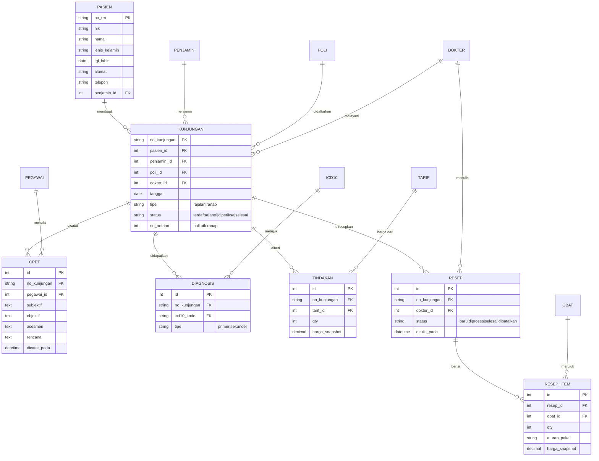
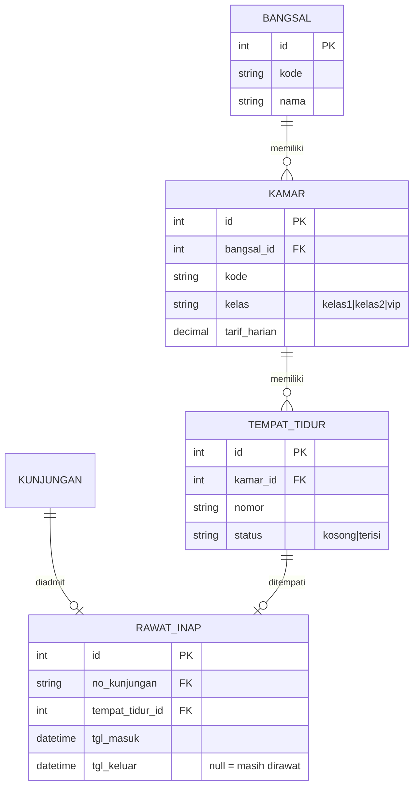
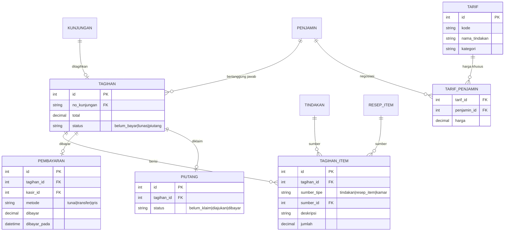

# ERD — SIMRS Prototype

> Status: **Final v1** — disetujui untuk dijadikan acuan desain schema.
> Format: Mermaid ER Diagram (stack-agnostic, belum terikat Laravel/Next).
> Scope: **29 fitur prototype** — Rawat jalan, Rawat inap (sederhana), Farmasi, Kasir & tagihan, Master (pegawai, dokter, aset, ICD-10) + kuitansi digital + jadwal dokter hari ini + modul RME eksplisit.

## Konsep Inti

- **`PASIEN` = identitas statis** — satu orang, satu baris, satu no. RM seumur hidup.
- **`KUNJUNGAN` = episode dinamis** — satu baris per kedatangan. Status lifecycle:
  - Rajalan: `terdaftar → antri → diperiksa → selesai`
  - Ranap: `admit → dirawat → pulang`
- "Pasien sedang dalam proses" = `KUNJUNGAN` dengan `status != selesai`.
- "Pasien punya history" = semua detail yang tergantung di kunjungan lampau (CPPT, diagnosis, tindakan, resep).

---

## Area 1 — Inti Pelayanan (pasien → kunjungan → layanan)



## Area 2 — Rawat Inap



## Area 3 — Keuangan (billing → bayar/piutang)



## Area 4 — Master Pendukung

```mermaid
erDiagram
    PEGAWAI ||--o| DOKTER : "menjadi"
    DOKTER ||--o{ JADWAL_PRAKTIK : "punya"
    POLI ||--o{ JADWAL_PRAKTIK : "di"
    OBAT ||--o{ MUTASI_STOK : "bermutasi"

    PEGAWAI {
        int id PK
        string nip
        string nama
        string jabatan "dokter|perawat|kasir|adm|farmasi"
        string telepon
        string status_aktif
    }
    DOKTER {
        int pegawai_id PK_FK
        string spesialisasi
        string no_sip
        decimal tarif_konsultasi
    }
    JADWAL_PRAKTIK {
        int id PK
        int pegawai_id FK
        int poli_id FK
        string hari "senin..minggu"
        time jam_mulai
        time jam_selesai
    }
    OBAT {
        int id PK
        string kode
        string nama
        string satuan
        string kategori
        decimal harga_jual
        int stok_saldo
    }
    MUTASI_STOK {
        int id PK
        int obat_id FK
        string tipe "masuk|keluar"
        int qty
        string keterangan "penerimaan|penjualan_resep"
        datetime created_at
    }
    ASET {
        int id PK
        string kode
        string nama
        string kategori "medis|non-medis"
        string lokasi
        string kondisi "baik|rusak|perbaikan"
        decimal nilai_perolehan
        date tgl_perolehan
    }
    ICD10 {
        string kode PK
        string nama_penyakit
    }
```

---

## Pemetaan Fitur → Entitas (29 fitur scope final)

Bukti bahwa seluruh fitur terlayani oleh ERD — termasuk 2 fitur tambahan, tanpa entitas baru:

| # | Fitur | Entitas pendukung |
|---|---|---|
| 1 | Registrasi pasien baru | `PASIEN` |
| 2 | Pencarian pasien (RM/NIK/nama) | `PASIEN` |
| 3 | Profil pasien 360° (aktif + history) | `PASIEN` 1—N `KUNJUNGAN` + detail |
| 4 | Riwayat medis per kunjungan | `CPPT`, `DIAGNOSIS`, `TINDAKAN`, `RESEP` |
| 5 | Registrasi kunjungan rajalan | `KUNJUNGAN` |
| 6 | Antrian poli | `KUNJUNGAN.no_antrian` + status |
| 7 | CPPT/SOAP | `CPPT` |
| 8 | Diagnosis ICD-10 (primer/sekunder) | `DIAGNOSIS` → `ICD10` |
| 9 | Tindakan dari master tarif | `TINDAKAN` → `TARIF`, `TARIF_PENJAMIN` |
| 10 | Resep elektronik | `RESEP` → `RESEP_ITEM` → `OBAT` |
| 11 | Master obat | `OBAT` |
| 12 | Kartu stok | `MUTASI_STOK` + `OBAT.stok_saldo` |
| 13 | Penerimaan obat (sederhana) | `MUTASI_STOK` (tipe `masuk`) |
| 14 | Dispensi resep | `RESEP.status` + `MUTASI_STOK` (tipe `keluar`) |
| 15 | Billing otomatis | `TAGIHAN` + `TAGIHAN_ITEM` (polimorfik) |
| 16 | Pembayaran + kuitansi | `PEMBAYARAN` |
| 17 | Logika penjamin (umum vs BPJS) | `PENJAMIN`, `TARIF_PENJAMIN`, `PIUTANG` |
| 18 | Bed board | `BANGSAL` → `KAMAR` → `TEMPAT_TIDUR` |
| 19 | Admit pasien ranap | `RAWAT_INAP` |
| 20 | Layanan harian ranap | `CPPT` + `TINDAKAN` (tipe ranap) |
| 21 | Pulang + billing ranap | `RAWAT_INAP.tgl_keluar` + `TAGIHAN_ITEM` (sumber `kamar`) |
| 22 | Master karyawan & dokter | `PEGAWAI`, `DOKTER` |
| 23 | Jadwal praktik | `JADWAL_PRAKTIK` |
| 24 | Master penjamin | `PENJAMIN` |
| 25 | Master poli & tarif | `POLI`, `TARIF`, `TARIF_PENJAMIN` |
| 26 | Master aset | `ASET` |
| 27 | **Kuitansi digital (PDF)** | `TAGIHAN` + `TAGIHAN_ITEM` + `PEMBAYARAN` (render read-only, nol entitas baru) |
| 28 | **Jadwal dokter hari ini** | `JADWAL_PRAKTIK` + `DOKTER` + `POLI` (query hari berjalan, nol entitas baru) |
| 29 | **Rekam Medis Elektronik (RME)** — modul eksplisit, agregat semua data klinis pasien | `PASIEN` + `KUNJUNGAN` + `CPPT` + `DIAGNOSIS` + `TINDAKAN` + `RESEP` (nol entitas baru) |

Di luar scope (keputusan final): layar antrian publik, notifikasi WA mock, feedback pasien, IGD, operasi, lab, radiologi, pengadaan penuh, laporan kompleks.

## Keputusan Desain

1. **`harga_snapshot`** pada `TINDAKAN` & `RESEP_ITEM` — harga master boleh berubah, tagihan historis tidak ikut berubah.
2. **`KUNJUNGAN` tunggal untuk rajalan & ranap** (kolom `tipe`) — ranap hanya punya detail tambahan di `RAWAT_INAP`. Riwayat pasien = satu query.
3. **`TAGIHAN_ITEM` polimorfik** (`sumber_tipe` + `sumber_id`) — satu mekanisme menampung sumber biaya tindakan, obat, dan kamar.
4. **Tarif per penjamin** — `TARIF` master + `TARIF_PENJAMIN` variasi harga (umum vs BPJS vs perusahaan).
5. **`ASET` & `ICD10` standalone** — tidak menyentuh alur pasien; ICD-10 hanya data referensi seed.
6. **`MUTASI_STOK` sebagai kartu stok** — saldo di kolom `OBAT.stok_saldo`, jejak masuk/keluar di mutasi.
7. **Antrian implisit di `KUNJUNGAN`** — `no_antrian` nullable, hanya dipakai rajalan; tidak perlu tabel antrian terpisah untuk prototype.

## Statistik

- **26 entitas**: pasien, penjamin, poli, pegawai, dokter, jadwal_praktik, icd10, kunjungan, cppt, diagnosis, tarif, tarif_penjamin, tindakan, resep, resep_item, obat, mutasi_stok, bangsal, kamar, tempat_tidur, rawat_inap, tagihan, tagihan_item, pembayaran, piutang, aset.
- **4 area**: pelayanan, ranap, keuangan, master.
- **29 fitur** terpetakan ke entitas (lihat tabel di atas).

## Open Items (menunggu keputusan)

- [ ] Stack teknologi (Laravel+MySQL vs Next.js+PostgreSQL) — menentukan tipe data fisik & naming convention
- [ ] Format no. RM: auto-increment sederhana vs standar Kemenkes (10 digit)
- [ ] No. kunjungan: format `YYYYMMDD-####` atau UUID
